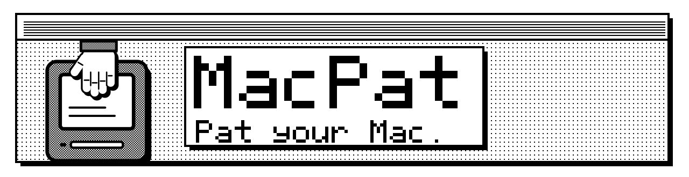
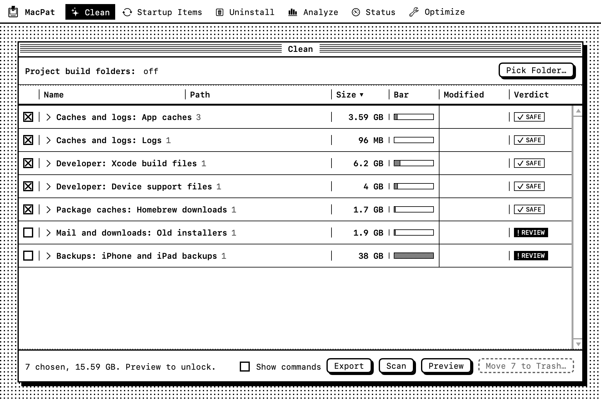
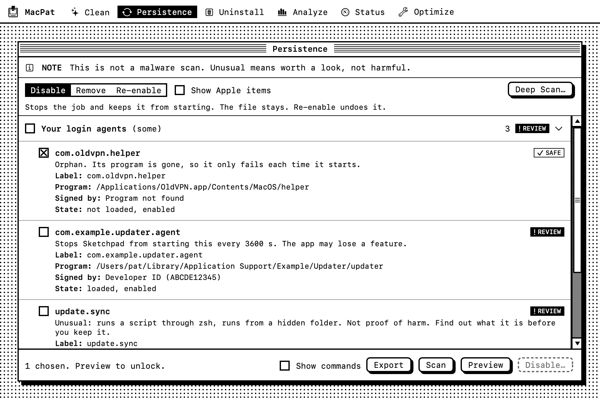
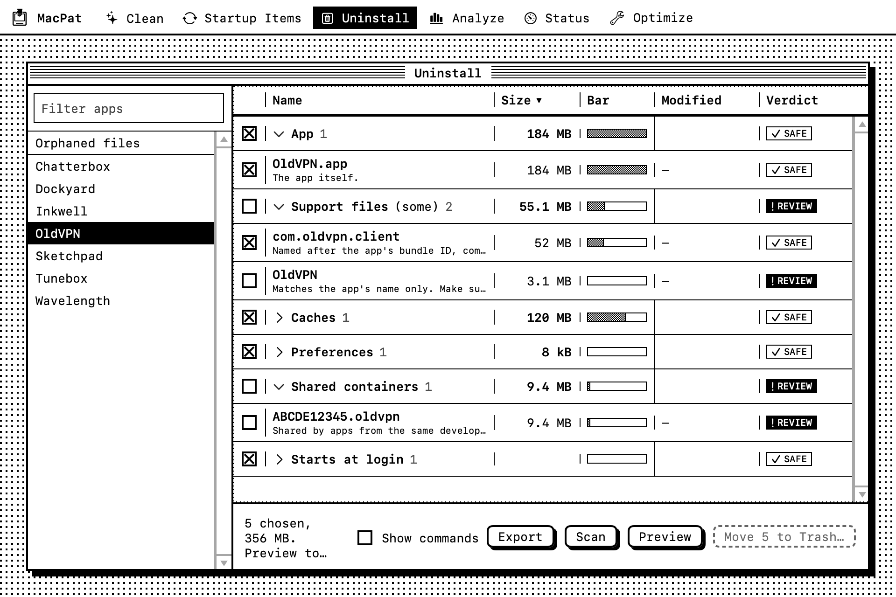
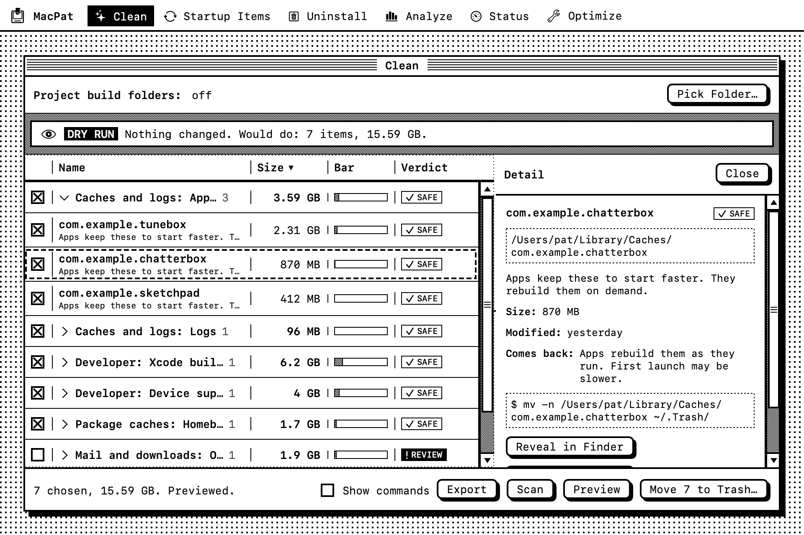
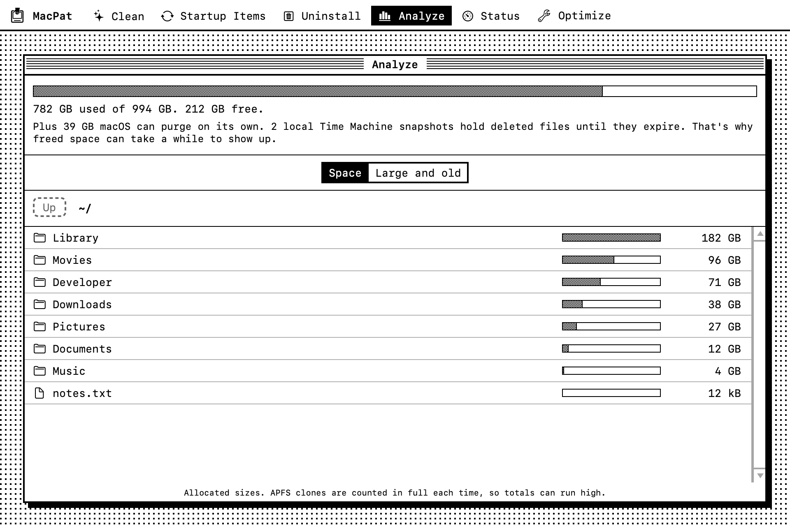
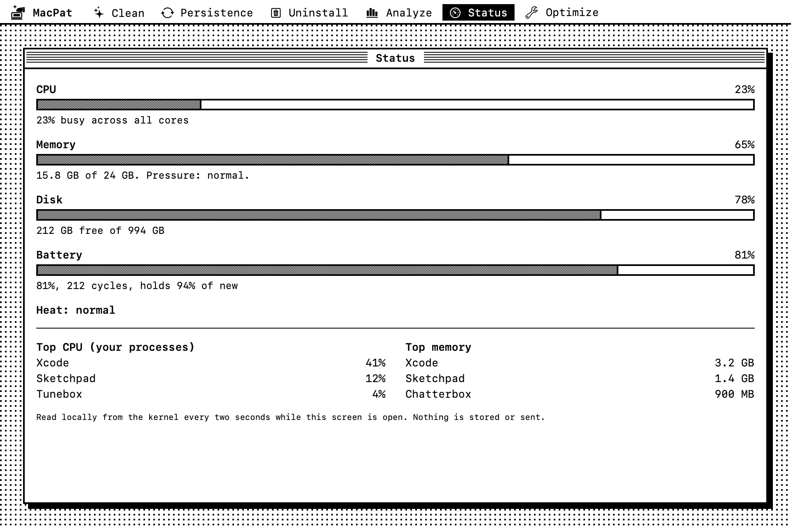
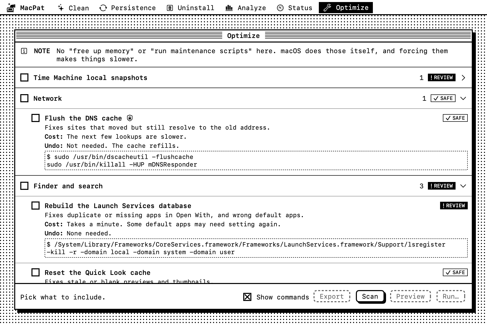

<p align="center">
  <picture>
    <source media="(prefers-color-scheme: dark)" srcset="docs/media/banner-dark.svg">
    
  </picture>
</p>

[](https://github.com/patsaade/macpat/actions/workflows/ci.yml)
[](LICENSE)

MacPat is a small, open-source Mac cleaner for Apple silicon. Before it touches anything, it shows you each item it would take, why, and the exact command behind it.

<picture>
  <source media="(prefers-color-scheme: dark)" srcset="docs/media/clean-flow-dark.gif">
  
</picture>

**Status:** version 0.1.0, early. It works on my Mac. Back up before you use it on yours.

## What it does

| Module | Does |
| --- | --- |
| Clean | Caches, logs, Xcode leftovers, package manager caches, old installers, project build folders. |
| Startup Items | Everything that starts on its own: launch agents and daemons, helpers, cron, login hooks, profiles, extensions, shell startup lines. Disable, remove, or re-enable. |
| Uninstall | An app plus its leftovers, ranked by how sure the match is. Also finds orphaned files. |
| Analyze | Where the space went, what macOS can purge, and big files nobody opened in months. |
| Status | CPU, memory, disk, battery, heat, and the top processes. |
| Optimize | A few fixes for specific problems: DNS, Open With, Quick Look, Spotlight, local snapshots. |

## How it stays safe

- **Preview first.** Run stays locked until you preview that exact choice. If anything changes, it locks again.
- **Trash, not delete.** Even root-owned files go to your Trash. Two optional commands delete for good, and they say so.
- **Short lists.** It can only touch a fixed set of folders and run a fixed set of commands. Admin steps use the macOS password prompt each time.

Read the [disclaimer](docs/explanation/disclaimer.md) first. This tool deletes files.

## Install

There is no download yet. The app isn't signed with a developer certificate or notarized, so I won't hand out a binary that macOS will fight you over. Build it yourself:

```sh
git clone https://github.com/patsaade/macpat.git
cd macpat
brew install xcodegen
xcodegen generate
open MacPat.xcodeproj
```

You need macOS 26 or later, an Apple silicon Mac, and Xcode 26 or later. Press Run. See [build from source](docs/how-to/build-from-source.md).

## First run

Scan only reads. Nothing changes until you Preview, then Run. macOS may ask to let MacPat into folders such as Downloads and Mail. If you say no, those folders show as locked "Needs access" rows, not as empty. Full Disk Access shows everything. A build you made yourself is signed only for your Mac, so macOS asks again after each rebuild.

Command-1 to 6 switch modules. The Plan menu has Scan (Command-R), Preview (Shift-Command-P), and Show Commands. Everything MacPat moves is listed in `~/Library/Logs/MacPat`.

## Versions

Releases follow [semantic versioning](https://semver.org). Before 1.0, a minor version can change how things work. [CHANGELOG.md](CHANGELOG.md) lists what changed. Tags are `v0.1.0` and so forth.

## Screens

<details>
<summary>Startup Items, Uninstall, Analyze, Status, Optimize</summary>

<picture><source media="(prefers-color-scheme: dark)" srcset="docs/media/persistence-flow-dark.gif"></picture>

<picture><source media="(prefers-color-scheme: dark)" srcset="docs/media/uninstall-flow-dark.gif"></picture>

<picture><source media="(prefers-color-scheme: dark)" srcset="docs/media/clean-pane-dark.png"></picture>

<picture><source media="(prefers-color-scheme: dark)" srcset="docs/media/analyze-dark.png"></picture>

<picture><source media="(prefers-color-scheme: dark)" srcset="docs/media/status-dark.png"></picture>

<picture><source media="(prefers-color-scheme: dark)" srcset="docs/media/optimize-dark.png"></picture>

The images are the real views with made-up data. `scripts/snapshots.sh` makes them.
</details>

## Docs

[Tutorials, how-tos, reference, and explanation](docs/README.md). Also: [style guide](docs/STYLE.md), [privacy](PRIVACY.md), [security](SECURITY.md), [accessibility](ACCESSIBILITY.md), [colophon](COLOPHON.md), [contributing](CONTRIBUTING.md).

## License

[MIT](LICENSE). Copyright (c) 2026 Patrick Saade. MacPat is not affiliated with or endorsed by Apple Inc. Mac and macOS are trademarks of Apple Inc.
